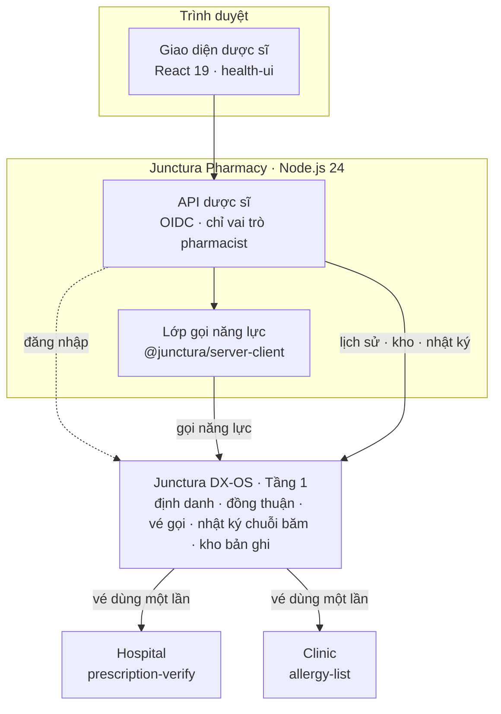
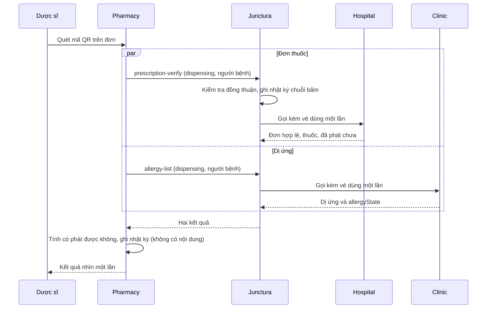

<!-- SPDX-FileCopyrightText: 2026 Junctura Contributors -->
<!-- SPDX-License-Identifier: Apache-2.0 -->

<div align="center">


# Junctura Pharmacy

**Phần mềm nguồn mở cho nhà thuốc — xác minh đơn và dị ứng trước khi phát thuốc, chỉ nhận đúng phần dữ liệu cần thiết khi người bệnh đồng ý.**

[](https://github.com/vku2-open-source-2026/junctura-pharmacy/actions/workflows/ci.yml)
[](LICENSE)
[](REUSE.toml)


[Giới thiệu](#giới-thiệu) · [Kiến trúc](#kiến-trúc) · [Bắt đầu nhanh](#bắt-đầu-nhanh) · [Cấu hình](#cấu-hình) · [Trang và API](#trang-và-api-chính) · [Tài liệu](#tài-liệu) · [Lộ trình](#lộ-trình)

</div>

---

## Giới thiệu

Người bệnh mang đơn thuốc từ bệnh viện ra nhà thuốc. Dược sĩ khó biết đơn còn hiệu lực không, đã phát ở nơi khác chưa, và người bệnh có dị ứng với thuốc trong đơn không. Hỏi lại thì mất thời gian; xin cả hồ sơ thì nhận nhiều hơn mức cần thiết.

**Junctura Pharmacy** là ứng dụng nhà thuốc trong [Junctura Health](https://github.com/vku2-open-source-2026/junctura-health), Tầng 2 của [Junctura DX-OS](https://github.com/vku2-open-source-2026/junctura-dxos). Pharmacy giải quyết bài toán theo hai phần:

- **Việc hằng ngày của nhà thuốc** — quét mã trên đơn, xem kết quả xác minh trong một màn hình, phát thuốc theo lô hoặc từ chối có lý do, quản lý kho và xem lại lịch sử.
- **Chỉ hỏi phần cần thiết, qua Junctura** — Pharmacy không giữ hồ sơ người bệnh. Đơn thuốc lấy từ bệnh viện, danh sách dị ứng lấy từ trạm y tế, và chỉ khi người bệnh đã đồng ý cho mục đích phát thuốc. Mọi lần hỏi đều để lại dấu vết.

> Dữ liệu là **dữ liệu giả lập**, không có thông tin người thật.

### Ai dùng và dùng để làm gì

| Vai trò | Việc chính |
| --- | --- |
| **Dược sĩ** (`pharmacist`) | Xác minh đơn, xem dị ứng, phát thuốc theo lô, từ chối có lý do, nhập kho, xem lịch sử và nhật ký |
| **Người bệnh** | Mang đơn có mã QR; quyết định có cho nhà thuốc xem dữ liệu hay không (qua MyHealth) |
| **Bệnh viện, trạm y tế** | Trả lời câu hỏi của nhà thuốc qua Junctura (không đăng nhập vào Pharmacy) |

## Tính năng nổi bật

**Xác minh đơn**
- Quét mã QR trên đơn bằng camera của laptop hoặc điện thoại (cần HTTPS hoặc localhost), bằng máy quét gõ như bàn phím, hoặc nhập tay mã đơn và mã người bệnh.
- Một màn hình cho biết: đơn hợp lệ không, ngày kê, hạn dùng, danh sách thuốc, đã phát chưa, và dị ứng của người bệnh, kèm nguồn và thời điểm nhận dữ liệu.
- Danh sách dị ứng rỗng luôn là "chưa ghi nhận", không bao giờ là "không dị ứng"; không lấy được thông tin dị ứng thì nhắc dược sĩ hỏi người bệnh trước khi phát.
- Chưa có đồng thuận thì hiện rõ "người bệnh chưa đồng ý", không hiện như dữ liệu rỗng.
- **Cảnh báo dị ứng trên từng dòng thuốc**, theo tên và nhóm dị ứng phổ biến (ví dụ dị ứng Penicillin thì cảnh báo Amoxicillin). Phát thuốc trùng dị ứng phải ghi lý do; máy chủ tự tính lại và lưu lý do. Đây là lưới an toàn, không thay đánh giá chuyên môn.

**Hôm nay**
- Trang tổng quan trong ngày theo giờ Việt Nam: số đơn đã xác minh, đã phát, đã từ chối, chưa có đồng thuận và phát dù trùng dị ứng.
- Lô thuốc cần chú ý (hết hạn, hết hàng, sắp hết hạn, sắp hết) và 5 đơn phát/từ chối gần nhất; phần nào lỗi chỉ báo phần đó.

**Phát thuốc và kho**
- Phát từng dòng thuốc với số lượng và lô **chọn từ kho** (gợi ý lô hết hạn sớm nhất còn đủ hàng) hoặc nhập tay; hỏi xác nhận trước khi ghi. Máy chủ **xác minh lại đơn** trước khi ghi, không tin kết quả cũ từ trình duyệt.
- Không cho phát đơn hết hạn, đơn đã phát, thuốc hoặc số lượng không khớp đơn, lô đã hết hạn hoặc không đủ hàng.
- Từ chối phát luôn kèm lý do.
- Kho theo lô: tồn kho = số đã nhập trừ số đã phát và số đã điều chỉnh; cảnh báo lô sắp hết, hết hàng, sắp hết hạn, đã hết hạn; nhập lô, xuất hủy, kiểm kê (đều có lý do); xem theo lô hoặc gộp theo thuốc, tìm không dấu, lọc theo trạng thái. Ngưỡng "sắp hết" và "sắp hết hạn" chỉnh trong Cài đặt.

**Lịch sử và nhật ký**
- Lịch sử các đơn đã phát và đã từ chối, không hiện mã người bệnh; mở từng lần để xem và **in phiếu phát thuốc**.
- "Nhật ký Junctura": mỗi lần nhà thuốc hỏi Junctura — năng lực nào, mục đích, kết quả, đơn nào, dược sĩ nào. Không lưu người bệnh, thuốc hay dị ứng.
- "Nhật ký thao tác": ai xác minh, phát, từ chối, nhập kho, điều chỉnh kho, đổi cài đặt, lúc nào.

**Báo cáo và tiện ích**
- Báo cáo theo khoảng ngày (tối đa 92 ngày): số đơn phát và từ chối theo ngày, số lượng theo thuốc, lý do từ chối, tỷ lệ từ chối, phát dù trùng dị ứng, bị chặn vì chưa đồng thuận; tải CSV mở đúng tiếng Việt trong Excel. Chỉ có số đếm, không có người bệnh.
- Tìm nhanh từ mọi màn (`/` hoặc Ctrl+K): trang, mã đơn, thuốc, số lô. Mã đơn hiện bằng font đơn cách, có nút sao chép.
- Giao diện dựng trên [`@junctura/health-ui`](https://www.npmjs.com/package/@junctura/health-ui): sáng/tối, cỡ chữ, dùng được trên điện thoại.

## Kiến trúc



Pharmacy không gọi thẳng ứng dụng khác và không đọc cơ sở dữ liệu của ứng dụng khác; mọi trao đổi đi qua Junctura. Lịch sử phát thuốc, kho và nhật ký lưu trong kho bản ghi của Tầng 1, nên Pharmacy không cần cơ sở dữ liệu riêng.

### Một lần xác minh đơn diễn ra thế nào



### Hai năng lực Pharmacy gọi

Theo [hợp đồng dùng chung](https://github.com/vku2-open-source-2026/junctura-health/tree/main/contracts) (`@junctura/health-contracts` 1.1.0). Pharmacy chỉ là bên gọi, không cung cấp năng lực nào.

| Năng lực | Bên cung cấp | Mục đích | Cấp cứu |
| --- | --- | --- | --- |
| `prescription-verify` | Hospital | `dispensing` | Không |
| `allergy-list` | Clinic | `dispensing` | Có |

Kết quả mỗi lần gọi là một trong: `ok`, `no-consent`, `not-authorized`, `unavailable`, `failed`, `invalid-output`.

### Mã QR trên đơn

Mọi năng lực đều cần biết người bệnh (`context.dataSubject`), nên mã QR trên đơn chứa cả mã đơn và mã người bệnh theo quy ước tạm `JH1|RX|<mã đơn>|<mã người bệnh>`, ví dụ `JH1|RX|DT-2026-004521|3f8a2c1e-9b4d-4c7a-8e2f-1a2b3c4d5e6f`. Mã đơn dài 1–32 ký tự và không chứa `|`; mã người bệnh là UUID chữ thường. Quy ước sẽ chuyển sang bộ đọc dùng chung khi `@junctura/health-contracts` có.

### Mô hình bảo mật

| Lớp | Cơ chế |
| --- | --- |
| Xác thực | Đăng nhập Junctura (OpenID Connect, PKCE); máy chủ kiểm tra chữ ký RS256, nhà cấp và hạn của token. Chỉ tài khoản dược sĩ của ứng dụng này vào được; người khác nhận 403 |
| Lấy dữ liệu | Chỉ qua Junctura, mục đích `dispensing`, người bệnh đi qua `context.dataSubject`; kết quả được kiểm tra theo schema của hợp đồng |
| Ghi dữ liệu | Máy chủ xác minh lại đơn trước khi phát; số lượng và thuốc phải khớp đơn; hàm lượng lấy từ đơn, không lấy từ trình duyệt |
| Riêng tư | Phản hồi API, lịch sử và nhật ký không có mã người bệnh; nhật ký không chứa thuốc hay dị ứng; máy chủ chỉ ghi mã lỗi ra log |
| Đầu vào | JSON tối đa 4 KiB, đúng `content-type`; sai thì trả 400, 413 hoặc 415 |
| Bí mật | Thông tin kết nối Junctura nằm trong biến môi trường hoặc file `.env` (đã loại khỏi git); không đưa ra trình duyệt, không đóng vào ảnh Docker |

## Bắt đầu nhanh

**Yêu cầu:** Git, Node.js 24 (xem `.node-version`). Chạy đủ cả hệ thống cần thêm Docker, [junctura-dxos](https://github.com/vku2-open-source-2026/junctura-dxos) đang chạy (`npm run local:up`) và [junctura-health](https://github.com/vku2-open-source-2026/junctura-health) đã chạy `npm run demo:setup`. Hai repo này nằm cạnh thư mục Pharmacy; nếu ở nơi khác, đặt `JUNCTURA_HEALTH_DIR`.

```sh
git clone https://github.com/vku2-open-source-2026/junctura-pharmacy.git
cd junctura-pharmacy
npm ci                # cài thư viện máy chủ từ lockfile
npm run web:install   # cài thư viện giao diện từ lockfile
npm run build         # build giao diện vào web/dist
npm run seed:stock    # (tùy chọn) nạp kho thuốc mẫu
npm run seed:activity # (tùy chọn) nạp 30 ngày hoạt động giả lập
npm start             # chạy máy chủ
```

Mở <http://localhost:5184> và đăng nhập bằng `duocsi.nhathuoc`. Mật khẩu nằm trong `.junctura/demo/accounts.env` của junctura-health.

**Chạy bằng Docker.** Ảnh dựng từ [`Dockerfile`](Dockerfile) (build nhiều giai đoạn, chạy bằng người dùng không phải root). Thông tin kết nối truyền bằng `--env-file`, junctura-health gắn ở chế độ chỉ đọc:

```sh
docker build -t junctura-pharmacy:dev .
docker run --rm -p 5184:5184 \
  -v "$(pwd)/../junctura-health:/junctura-health:ro" \
  --env-file ../junctura-health/.junctura/demo/junctura-pharmacy.env \
  junctura-pharmacy:dev
```

Nếu `JUNCTURA_URL` trỏ tới Junctura chạy trên máy chủ, thêm `--add-host=host.docker.internal:host-gateway` và đổi `JUNCTURA_URL` trong env-file cho phù hợp.

**Phát triển giao diện.** Chạy `npm run dev:server` (API, cổng 5194) và `npm run dev` (giao diện, cổng 5184, tự chuyển `/api` sang 5194).

**Thử trọn luồng khi Hospital, Clinic, MyHealth chưa chạy (chỉ khi phát triển).** Hai công cụ trong `scripts/` thay tạm cho các ứng dụng đó; chúng không thuộc Pharmacy và bỏ đi khi ứng dụng thật có:

```sh
# Provider tạm đóng vai Hospital (prescription-verify) và Clinic (allergy-list) từ dữ liệu mẫu
# của junctura-health (chỉ đọc), qua đúng cơ chế đổi vé của Junctura.
# Cần junctura-dxos đã bật C4A, có mạng providers và chứng chỉ (npm run provider:pki -- clinic hospital).
DEV_PROVIDER_UID=$(id -u) npm run dev:providers

# Đồng thuận mẫu của một người bệnh cho Nhà thuốc (như MyHealth sẽ làm); --revoke để thu hồi.
npm run dev:consent -- benhnhan.an
```

Provider tạm thêm một đơn kịch bản `DT-2026-004537` (Amoxicillin cho Nguyễn Văn An, dị ứng Penicillin) để thử cảnh báo dị ứng.

### Lệnh thường dùng

| Lệnh | Tác dụng |
| --- | --- |
| `npm start` | Chạy máy chủ và giao diện đã build |
| `npm run build` | Build giao diện vào `web/dist` |
| `npm run dev:server` · `npm run dev` | Chạy API và giao diện ở chế độ phát triển |
| `npm run seed:stock` | Nạp kho mẫu từ danh mục thuốc dùng chung; chạy lại không nhân đôi |
| `npm run seed:activity` | Nạp khoảng 30 ngày hoạt động giả lập (phát, từ chối, gọi Junctura, nhật ký) để các trang Hôm nay, Báo cáo, Lịch sử, Nhật ký có số liệu; chỉ nạp một lần |
| `npm run dev:providers` · `npm run dev:consent` | Provider tạm và đồng thuận mẫu để thử trọn luồng khi phát triển |
| `npm run check` | Kiểm tra header SPDX, giấy phép và thư viện |
| `npm run check:reuse` | Kiểm tra tuân thủ REUSE 3.3 (cần `pip install -r requirements-reuse.txt`, hoặc `docker run --rm -v "$PWD":/data fsfe/reuse:6.2.0 lint`) |
| `npm test` · `npm run web:test` | Kiểm thử máy chủ · kiểm thử giao diện |

## Cấu hình

Máy chủ đọc kết nối từ `.junctura/demo/junctura-pharmacy.env` do `demo:setup` tạo (mẫu: [`.env.example`](.env.example)); thiếu biến bắt buộc thì nó báo rõ biến đó. Biến môi trường thật luôn thắng giá trị trong file.

| Biến | Ý nghĩa | Mặc định |
| --- | --- | --- |
| `JUNCTURA_HEALTH_DIR` | Vị trí repo junctura-health (danh sách nhân viên, file kết nối) | `../junctura-health` |
| `JUNCTURA_PHARMACY_ENV` | Dùng file kết nối khác | `<JUNCTURA_HEALTH_DIR>/.junctura/demo/junctura-pharmacy.env` |
| `JUNCTURA_ISSUER`, `JUNCTURA_WEB_CLIENT_ID` | Nhà cấp định danh và client đăng nhập của giao diện (bắt buộc) | không có |
| `JUNCTURA_URL`, `JUNCTURA_APP_CLIENT_ID`, `JUNCTURA_APP_CLIENT_SECRET` | Gateway của Junctura và tài khoản kỹ thuật của máy chủ; thiếu thì vẫn đăng nhập được nhưng xác minh, phát thuốc, kho và nhật ký trả 503 | không có |
| `PORT` (hoặc `WEB_PORT`), `HOST` | Địa chỉ lắng nghe của giao diện và API | `5184`, `127.0.0.1` |
| `PHARMACY_STATIC_DIR` | Thư mục giao diện đã build | `web/dist` |

## Trang và API chính

| Trang | Địa chỉ |
| --- | --- |
| Xác minh đơn (kèm phát thuốc và từ chối) | `/` |
| Hôm nay | `/hom-nay` |
| Lịch sử · Phiếu phát thuốc | `/lich-su` · `/lich-su/<id>` |
| Kho | `/kho` |
| Báo cáo | `/bao-cao` |
| Nhật ký Junctura | `/nhat-ky` |
| Nhật ký thao tác | `/nhat-ky-thao-tac` |
| Cài đặt | `/cai-dat` |

Mọi API dưới đây cần đăng nhập bằng tài khoản dược sĩ, trừ `/api/config` và `/healthz`.

| Endpoint | Mô tả |
| --- | --- |
| `POST /api/verify` | Xác minh đơn (`{ qr }` hoặc `{ prescriptionCode, patient }`): đơn, dị ứng, có phát được không và lý do |
| `POST /api/dispense` | Phát thuốc theo lô; máy chủ xác minh lại đơn, chặn lô hết hạn hoặc thiếu hàng, bắt buộc `allergyOverride` khi thuốc trùng dị ứng |
| `POST /api/refuse` | Từ chối phát, kèm lý do 3–200 ký tự |
| `GET /api/history` · `GET /api/history/<id>` | Lịch sử phát và từ chối · một lần phát (cho phiếu in) |
| `GET /api/stock` · `POST /api/stock` | Tồn kho theo lô · nhập lô mới |
| `POST /api/stock/adjust` | Xuất hủy (`kind: "dispose"`) hoặc kiểm kê (`kind: "count"`), kèm lý do |
| `GET /api/report` · `GET /api/report.csv` | Báo cáo theo khoảng ngày (`from`, `to`) · bản CSV |
| `GET /api/audit` | Nhật ký thao tác của nhân viên |
| `GET /api/settings` · `PUT /api/settings` | Ngưỡng sắp hết (`lowStock`) và sắp hết hạn (`expiringDays`) |
| `GET /api/call-log` | Nhật ký các lần gọi Junctura |
| `GET /api/overview` | Tổng quan trong ngày (giờ Việt Nam), kho cần chú ý và đơn gần đây |
| `GET /api/me` · `GET /api/config` · `GET /healthz` | Người đang đăng nhập · cấu hình công khai · kiểm tra sống |

## Công nghệ

| Thành phần | Công nghệ |
| --- | --- |
| Máy chủ | Node.js 24, không framework; [`@junctura/server-client`](https://www.npmjs.com/package/@junctura/server-client), [`@junctura/health-contracts`](https://www.npmjs.com/package/@junctura/health-contracts) |
| Lưu trữ | Kho bản ghi của Junctura (lịch sử, kho, nhật ký); không có cơ sở dữ liệu riêng |
| Giao diện | React 19, Vite, TypeScript, Tailwind CSS, [`@junctura/health-ui`](https://www.npmjs.com/package/@junctura/health-ui), `lucide-react` |
| Quét mã QR | `BarcodeDetector` khi trình duyệt hỗ trợ, [`jsqr`](https://www.npmjs.com/package/jsqr) làm dự phòng và vẽ khung hình lên canvas |
| Đóng gói, CI | npm, Docker, GitHub Actions |

Thư viện bên thứ ba được khai trong `package.json` và `package-lock.json` (gốc và `web/`), cài từ registry; không chép mã nguồn của chúng vào repo.

## Tài liệu

| | |
| --- | --- |
| [CONTRIBUTING.md](CONTRIBUTING.md) | Quy trình đóng góp, quy tắc bắt buộc |
| [CHANGELOG.md](CHANGELOG.md) | Lịch sử thay đổi |
| [SECURITY.md](SECURITY.md) | Cách báo lỗ hổng bảo mật |
| [CODE_OF_CONDUCT.md](CODE_OF_CONDUCT.md) | Quy tắc ứng xử |
| [THIRD-PARTY.md](THIRD-PARTY.md) | Thư viện bên thứ ba, phiên bản và giấy phép |
| [`.env.example`](.env.example) | Mẫu biến môi trường |
| [Tính năng từng ứng dụng](https://github.com/vku2-open-source-2026/junctura-health/blob/main/docs/APPS.md) | Phạm vi Pharmacy trong Junctura Health |
| [Hợp đồng năng lực](https://github.com/vku2-open-source-2026/junctura-health/tree/main/contracts) | Dữ liệu vào, ra, mục đích được phép |
| [Dựng ứng dụng Tầng 2 mới](https://github.com/vku2-open-source-2026/junctura-health/blob/main/docs/new-app.md) | Cách Pharmacy được dựng trên Junctura |
| [Junctura DX-OS](https://github.com/vku2-open-source-2026/junctura-dxos) | Tầng 1: định danh, đồng thuận, vé gọi, nhật ký |

## Cấu trúc thư mục

```text
server/         API, đăng nhập, gọi năng lực, xác minh, phát thuốc, kho, nhật ký
web/            giao diện React (web/src)
tests/          kiểm thử máy chủ
scripts/        kiểm tra SPDX và REUSE, nạp kho mẫu
docs/assets/    logo
Dockerfile      ảnh container (build nhiều giai đoạn)
```

## Kiểm thử

```sh
npm run check         # header SPDX, giấy phép, thư viện
npm run check:reuse   # REUSE 3.3
npm test              # máy chủ: đăng nhập, gọi năng lực, xác minh, phát thuốc, kho, nhật ký
npm run web:test      # giao diện: xác minh, phát thuốc, lịch sử, kho, nhật ký
```

GitHub Actions chạy cả bốn lệnh và build giao diện ở mỗi Pull Request.

## Lộ trình

- [x] Đăng nhập Junctura cho dược sĩ.
- [x] Gọi `prescription-verify` và `allergy-list` qua Junctura.
- [x] Xác minh đơn bằng QR hoặc nhập tay, cảnh báo dị ứng.
- [x] Phát thuốc theo lô, từ chối có lý do, lịch sử.
- [x] Kho theo lô và nhật ký các lần gọi Junctura.
- [x] Cảnh báo dị ứng theo nhóm thuốc, quét QR bằng camera, trang Hôm nay.
- [x] Chọn lô từ kho, xác nhận trước khi phát, phiếu phát in được, nhật ký thao tác.
- [x] Xuất hủy và kiểm kê kho, báo cáo CSV, cài đặt ngưỡng, tìm nhanh.
- [x] Đóng gói Docker.
- [ ] Chạy cùng bộ năm ứng dụng bằng một lệnh `docker compose` của junctura-health.
- [ ] Đọc mã QR bằng bộ đọc dùng chung trong `@junctura/health-contracts`.
- [ ] Bản phát hành `v0.1.0` kèm gói `.tar.gz`.

Giới hạn hiện tại: dấu "đã phát" chỉ ghi ở nhà thuốc, bệnh viện chưa được báo lại; API liệt kê của kho bản ghi Junctura chỉ trả 100 bản ghi **đầu tiên** (cũ nhất) mỗi loại và chưa có phân trang, nên khi một loại vượt 100 bản ghi, bản ghi mới sẽ không hiện trong lịch sử, kho và nhật ký (đã báo nhóm Tầng 1); quét mã bằng camera chỉ dùng được trên HTTPS hoặc localhost. Tiến độ chi tiết ở [Issues](https://github.com/vku2-open-source-2026/junctura-pharmacy/issues).

## Đóng góp

Mọi đóng góp đều được hoan nghênh. Báo lỗi và đề xuất tại [Issues](https://github.com/vku2-open-source-2026/junctura-pharmacy/issues); lỗ hổng bảo mật báo theo [SECURITY.md](SECURITY.md). Trước khi gửi Pull Request, đọc [CONTRIBUTING.md](CONTRIBUTING.md) và [Quy tắc ứng xử](CODE_OF_CONDUCT.md). Commit theo chuẩn Conventional Commits và không bao giờ commit tệp `.env` hay khóa bí mật. Lịch sử thay đổi: [CHANGELOG.md](CHANGELOG.md).

## Giấy phép

Junctura Pharmacy là phần mềm tự do, phát hành theo [Apache License 2.0](LICENSE), một giấy phép nguồn mở được OSI phê chuẩn — Copyright 2026 Junctura Contributors. Bạn được dùng, sửa đổi và phân phối lại (kể cả cho mục đích thương mại), miễn là giữ lại thông báo bản quyền và giấy phép, ghi rõ các thay đổi; giấy phép cũng cấp quyền sử dụng bằng sáng chế liên quan và không kèm bảo hành.

<!-- REUSE-IgnoreStart -->
- Mỗi tệp mã nguồn đều ghi giấy phép bằng tiêu đề [SPDX](https://spdx.dev/) (`SPDX-License-Identifier: Apache-2.0`); các tệp không chứa được chú thích (JSON, dữ liệu) được khai báo trong [REUSE.toml](REUSE.toml). Dự án tuân thủ chuẩn [REUSE 3.3](https://reuse.software/), kiểm tra bằng `reuse lint`.
<!-- REUSE-IgnoreEnd -->
- Toàn văn giấy phép: [LICENSE](LICENSE) · thông báo bản quyền: [NOTICE](NOTICE).
- Thành phần bên thứ ba giữ giấy phép riêng và đều là giấy phép nguồn mở; chúng được khai trong `package.json`, cài từ registry, không chép hay sửa mã nguồn. Danh sách, phiên bản và giấy phép tại [THIRD-PARTY.md](THIRD-PARTY.md).
